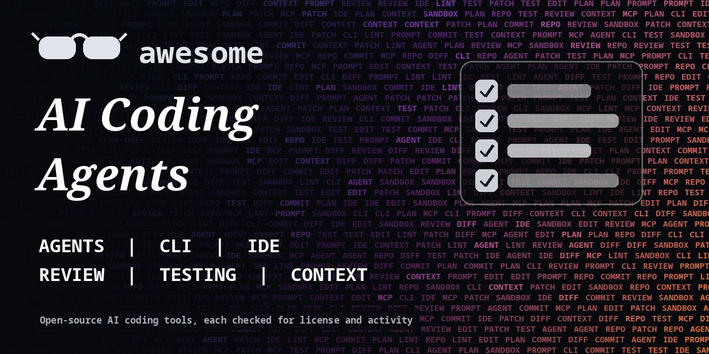

<h1 align="center">Awesome AI Coding Agents</h1>

> Open-source coding agents, editor extensions, CLI tools, review bots and developer workflows built around AI. Every entry shows its license.

**Rules of this list:** every repo exists, is public, is not archived, states a license and has had a commit in the last year. One plain sentence each. Star counts and claims are the authors' own, we did not test every tool. Checked 2026-10-18. See [CONTRIBUTING.md](CONTRIBUTING.md).

## Contents

- [Terminal and CLI coding agents](#terminal-and-cli-coding-agents)
- [Editor and IDE extensions](#editor-and-ide-extensions)
- [Autonomous software engineers](#autonomous-software-engineers)
- [Code review and PR bots](#code-review-and-pr-bots)
- [Testing and QA with AI](#testing-and-qa-with-ai)
- [Context, repo maps and docs](#context-repo-maps-and-docs)
- [App builders from prompts](#app-builders-from-prompts)
- [Sandboxes and runtimes](#sandboxes-and-runtimes)
- [Skills, rules and prompts](#skills-rules-and-prompts)
- [How to choose](#how-to-choose)
- [Contributing](#contributing)

## Terminal and CLI coding agents

Agents that work in your repo from the terminal.

- [aaif-goose/goose](https://github.com/aaif-goose/goose)  - Open-source, extensible AI agent that goes beyond code suggestions. _(Apache-2.0)_
- [Aider-AI/aider](https://github.com/Aider-AI/aider)  - AI pair programming in your terminal. _(Apache-2.0)_
- [anomalyco/opencode](https://github.com/anomalyco/opencode)  - Open-source AI coding agent built for the terminal. _(MIT)_
- [charmbracelet/crush](https://github.com/charmbracelet/crush)  - Glamourous agentic coding in your terminal. _(check repo)_
- [cline/cline](https://github.com/cline/cline)  - Autonomous coding agent in your IDE that edits files and runs commands with your approval. _(Apache-2.0)_
- [flisk-sh/flisk](https://github.com/flisk-sh/flisk)  - CLI that turns an empty folder into a running local stack for agent-built apps; generates Compose and Tilt from an autodetected app. (by the author) _(MIT)_
- [google-gemini/gemini-cli](https://github.com/google-gemini/gemini-cli)  - Open-source AI agent that brings Gemini into your terminal. _(Apache-2.0)_
- [Kilo-Org/kilocode](https://github.com/Kilo-Org/kilocode)  - Open-source AI coding agent for editors. _(MIT)_
- [openai/codex](https://github.com/openai/codex)  - Lightweight coding agent from OpenAI that runs in your terminal. _(Apache-2.0)_

## Editor and IDE extensions

Autocomplete and chat inside your editor.

- [continuedev/continue](https://github.com/continuedev/continue)  - Open-source AI code assistant for VS Code and JetBrains. _(Apache-2.0)_
- [deepseek-ai/DeepSeek-Coder](https://github.com/deepseek-ai/DeepSeek-Coder)  - Open code language models from DeepSeek. _(MIT)_
- [microsoft/vscode](https://github.com/microsoft/vscode)  - Visual Studio Code open-source editor. _(MIT)_
- [TabbyML/tabby](https://github.com/TabbyML/tabby)  - Self-hosted AI coding assistant. _(check repo)_
- [zed-industries/zed](https://github.com/zed-industries/zed)  - High-performance multiplayer code editor with built-in AI features. _(check repo)_

## Autonomous software engineers

Agents that take an issue to a pull request.

- [FoundationAgents/MetaGPT](https://github.com/FoundationAgents/MetaGPT)  - Multi-agent framework that plays software company roles. _(MIT)_
- [FoundationAgents/MetaGPT](https://github.com/FoundationAgents/MetaGPT)  - Multi-agent framework that plays software company roles. _(MIT)_
- [OpenHands/OpenHands](https://github.com/OpenHands/OpenHands)  - Platform for AI software development agents. _(MIT)_
- [Pythagora-io/gpt-pilot](https://github.com/Pythagora-io/gpt-pilot)  - Developer agent that builds apps step by step with you. _(check repo)_
- [SWE-agent/mini-swe-agent](https://github.com/SWE-agent/mini-swe-agent)  - Minimal agent that solves software issues in 100 lines. _(MIT)_
- [SWE-agent/SWE-agent](https://github.com/SWE-agent/SWE-agent)  - Agent that takes a GitHub issue and tries to fix it. _(MIT)_
- [SWE-bench/SWE-bench](https://github.com/SWE-bench/SWE-bench)  - Benchmark for evaluating language models on real GitHub issues. _(MIT)_

## Code review and PR bots

Automated feedback on changes.

- [anc95/ChatGPT-CodeReview](https://github.com/anc95/ChatGPT-CodeReview)  - Code review bot powered by language models. _(ISC)_
- [danger/danger](https://github.com/danger/danger)  - Automate common code review chores. _(MIT)_
- [reviewdog/reviewdog](https://github.com/reviewdog/reviewdog)  - Automated code review tool that posts linter results to pull requests. _(MIT)_
- [super-linter/super-linter](https://github.com/super-linter/super-linter)  - Combination of many linters to run as a GitHub Action. _(MIT)_
- [The-PR-Agent/pr-agent](https://github.com/The-PR-Agent/pr-agent)  - AI-powered pull request reviewer and assistant. _(MIT)_

## Testing and QA with AI

Generate and run tests.

- [microsoft/playwright](https://github.com/microsoft/playwright)  - End-to-end testing across browsers. _(Apache-2.0)_
- [promptfoo/promptfoo](https://github.com/promptfoo/promptfoo)  - Test prompts, agents and RAG, and red-team models. _(MIT)_
- [qodo-ai/qodo-cover](https://github.com/qodo-ai/qodo-cover)  - AI tool that generates tests to raise code coverage. _(AGPL-3.0)_

## Context, repo maps and docs

Give models the right code.

- [ast-grep/ast-grep](https://github.com/ast-grep/ast-grep)  - Fast structural code search and rewriting tool. _(MIT)_
- [mufeedvh/code2prompt](https://github.com/mufeedvh/code2prompt)  - CLI tool that turns a codebase into a prompt. _(MIT)_
- [sourcegraph/zoekt](https://github.com/sourcegraph/zoekt)  - Fast text search over source code. _(Apache-2.0)_
- [tree-sitter/tree-sitter](https://github.com/tree-sitter/tree-sitter)  - Incremental parsing system for programming tools. _(MIT)_
- [yamadashy/repomix](https://github.com/yamadashy/repomix)  - Pack your repo into a single AI-friendly file. _(MIT)_

## App builders from prompts

Generate small apps from a description.

- [abi/screenshot-to-code](https://github.com/abi/screenshot-to-code)  - Turn screenshots and designs into code. _(MIT)_
- [stackblitz-labs/bolt.diy](https://github.com/stackblitz-labs/bolt.diy)  - Community fork of Bolt that works with any model. _(MIT)_
- [vercel/ai](https://github.com/vercel/ai)  - TypeScript toolkit for building AI apps and agents. _(check repo)_
- [vercel/v0-sdk](https://github.com/vercel/v0-sdk)  - SDK for the v0 app generation API. The service is paid. _(check repo)_

## Sandboxes and runtimes

Run agent code safely.

- [devcontainers/spec](https://github.com/devcontainers/spec)  - Specification for development containers. _(CC-BY-4.0)_
- [e2b-dev/code-interpreter](https://github.com/e2b-dev/code-interpreter)  - Python and JavaScript code interpreter for AI apps. _(Apache-2.0)_
- [e2b-dev/E2B](https://github.com/e2b-dev/E2B)  - Open-source secure sandboxes for AI agent code. _(Apache-2.0)_
- [firecracker-microvm/firecracker](https://github.com/firecracker-microvm/firecracker)  - Secure microVMs for serverless workloads. _(Apache-2.0)_
- [google/gvisor](https://github.com/google/gvisor)  - Application kernel for containers, for stronger isolation. _(Apache-2.0)_

## Skills, rules and prompts

Reusable instructions for coding agents. Read them before you install.

- [modelcontextprotocol/servers](https://github.com/modelcontextprotocol/servers)  - Reference collection of Model Context Protocol servers. _(check repo)_
- [PatrickJS/awesome-cursorrules](https://github.com/PatrickJS/awesome-cursorrules)  - Collection of rules files for Cursor. _(CC0-1.0)_

## How to choose

- **Review every change.** Agents make plausible mistakes.
- **Run agents in a branch or sandbox,** not on production.
- **Do not paste secrets** into prompts.
- **Check where code is sent.** Local models keep it on your machine, hosted ones do not.

## Contributing

See [CONTRIBUTING.md](CONTRIBUTING.md). One entry per pull request, plain words, real sources only.

## About

Maintained by [@devanasolver](https://github.com/devanasolver). Listings follow the rules in CONTRIBUTING.

## Sponsor me

If this list is useful, [buy me a coffee](https://buymeacoffee.com/isaac49).
